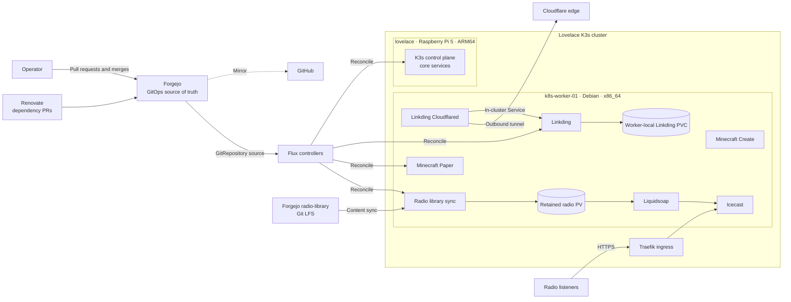
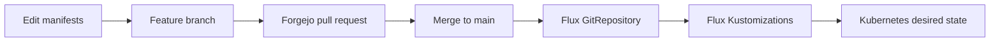
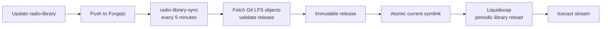

# Lovelace Cluster

Lovelace is a two-node, heterogeneous [K3s](https://k3s.io/) Kubernetes cluster managed declaratively with [Flux](https://fluxcd.io/). A Raspberry Pi 5 provides the ARM64 control plane, and a Debian x86_64 worker runs application workloads and hosts node-local application data.

**Forgejo is the authoritative Git repository.** Changes go through pull requests, reach `main` after review, and are reconciled by Flux. GitHub is an external mirror, not a separate deployment source.

## Architecture



The diagram shows **logical relationships and intended workload placement**, not every Pod or packet path. Traefik, Flux, networking components, and supporting controllers have their own scheduling rules.

### Nodes and placement

| Node | Platform | Node-pool label | Primary responsibility |
| --- | --- | --- | --- |
| `lovelace` | Raspberry Pi 5, ARM64 | `novalabs.io/node-pool=core` | K3s control plane and core cluster services |
| `k8s-worker-01` | Debian, x86_64 | `novalabs.io/node-pool=worker` | Application workloads and node-local storage |

Stateless Deployments generally use a **logical node-pool selector**. Stateful workloads using node-local PersistentVolumes use **`kubernetes.io/hostname` selectors** aligned with PV node affinity. Changing only a node selector does not move data between nodes.

The logical node-pool labels are operational prerequisites. If a node is rebuilt or rejoins the cluster, verify and restore its label before relying on pool-based scheduling.

See [Architecture](docs/architecture.md) and [Operations and recovery](docs/operations.md).

## Selected managed workloads

| Workload | Namespace | Scheduling / delivery | Persistent data | Access |
| --- | --- | --- | --- | --- |
| Linkding | `linkding` | Single-replica Deployment on `k8s-worker-01`; Cloudflared on the worker pool | `linkding-data-worker-pvc` (1 GiB, `local-path`) | Traefik and Cloudflare Tunnel |
| Minecraft Paper | `minecraft` | StatefulSet on `k8s-worker-01` | Retained, node-local PV | Playit Tunnel |
| Minecraft Create | `minecraft-create` | Stateful workload on `k8s-worker-01` | Node-local game-world storage | Cluster-specific external access configuration |
| Radio | `radio` | Icecast and Liquidsoap Deployments; library-sync CronJob | Retained node-local music PV | Traefik; restricted public stream path |
| Renovate | `renovate` | Hourly CronJob | No application PVC | Forgejo API |
| kube-prometheus-stack | `monitoring` | Flux-managed HelmRelease | Grafana UI-created data is not durable | Traefik ingress |

This is a selected inventory, not a full listing of Kubernetes system controllers or every application. For authoritative live placement, inspect Pods in the cluster.

**Linkding storage:** Linkding uses `linkding-data-worker-pvc` (1 GiB, `local-path`) on `k8s-worker-01`. The original control-plane PVC was retired following migration, with a verified cold backup retained outside Kubernetes. Linkding uses `RollingUpdate` with `maxSurge: 0` and `maxUnavailable: 1`, preventing surge Pods during single-replica rollouts.

**Retired application:** Audiobookshelf was removed from the cluster in November 2026, including its namespace and local-path storage.

See [Applications](docs/applications.md), [Minecraft](docs/minecraft.md), and [Radio](docs/radio.md) for workload-specific details.

## Repository layout

```text
.
├── apps/
│   ├── base/                    # Reusable application resources
│   └── staging/                 # Lovelace overlays, patches, encrypted Secrets
├── clusters/staging/            # Flux bootstrap and reconciliation entry points
├── infrastructure/controllers/  # Platform controllers and automation
├── monitoring/
│   ├── controllers/             # Helm repositories and releases
│   └── configs/                 # Monitoring configuration and ServiceMonitors
├── images/
│   └── radio-library-sync/      # Radio reconciliation container image
├── docs/                        # Architecture, runbooks, application guides
├── CONTRIBUTING.md              # Contribution and validation workflow
├── renovate.json                # Dependency update configuration
└── README.md
```

`base` directories define shared resources. `staging` overlays compose those resources and apply Lovelace-specific scheduling, storage, ingress, and SOPS-encrypted configuration. The radio content repository is separate from this infrastructure repository.

## GitOps reconciliation

Flux reconciles declarative state from Forgejo `main`. The principal Kustomizations are:

| Kustomization | Repository path | Responsibility |
| --- | --- | --- |
| `apps` | `./apps/staging` | Application resources |
| `infrastructure-controllers` | `./infrastructure/controllers/staging` | Supporting controllers and automation |
| `monitoring-controllers` | `./monitoring/controllers/staging` | Monitoring controllers and Helm releases |
| `monitoring-configs` | `./monitoring/configs/staging` | Monitoring configuration |

Flux bootstrap resources live under `clusters/staging`. SOPS decryption is configured for the reconciliation paths that consume encrypted Kubernetes Secrets.



Avoid routine imperative changes to Flux-managed workloads: reconciliation can overwrite them. Use a separate, reviewed change for storage deletion, node relocation, or other potentially destructive operations.

### Radio content delivery

Radio music is versioned separately in the Forgejo `NovaLabs/radio-library` repository using Git LFS. Its CronJob fetches and validates audio, publishes an immutable release directory, and atomically updates a `current` symlink. Liquidsoap can discover the updated library without restarting its Pod.



For library management, rollback, and image publishing, see [Radio](docs/radio.md).

## Working with this repository

### Prerequisites

- Access to the Forgejo repository and permission to open pull requests
- `git`
- `kubectl` with the correct Lovelace kubeconfig/context
- `flux` CLI
- `sops` and the appropriate public age recipient for encrypting new Secrets

Decryption private keys must **not** be placed in Git or shared in pull requests.

### Change workflow

```bash
git switch main
git pull --ff-only origin main
git switch -c feat/short-description
```

Edit the relevant manifests and documentation in the feature branch. Validate, review the diff, commit, push to Forgejo, and merge through a pull request. Flux deploys the merged desired state; a local branch or unmerged PR does not change the cluster.

### Render and validate

Render the full application reconciliation with the Flux CLI (the `apps/staging` directory is composed by Flux):

```bash
flux build kustomization apps --namespace flux-system --path ./apps/staging
```

For a focused application overlay:

```bash
kubectl kustomize apps/staging/linkding
```

Review the generated resource names, selectors, storage references, and deletion scope. For resources that can safely be submitted individually, use a **server-side dry-run** to check Kubernetes API compatibility before merging; a successful local render alone does not prove that an update will be accepted by the API server.

```bash
git diff --check
git status --short --branch
```

Before using server-side dry-run or applying resources, verify the `kubectl` context. Do not send encrypted SOPS documents directly to Kubernetes as though they were plaintext Secrets.

For encrypted manifests:

```bash
sops filestatus path/to/secret.sops.yaml
```

Expected encrypted status: `{"encrypted":true}`.

### Verify a reconciliation

```bash
flux get sources git -A
flux get kustomizations -A
flux get helmreleases -A
kubectl get nodes -o wide
kubectl get pods -A -o wide
```

After storage or scheduling changes, also verify PVC/PV binding, PV node affinity, workload readiness, and actual application behavior. A `Ready` Kubernetes resource does not by itself prove data integrity or functional correctness.

See [GitOps workflow](docs/gitops-workflow.md) and [Contributing](CONTRIBUTING.md).

## Secrets, storage, and recovery

- **SOPS + age:** commit only encrypted Secret manifests; keep age identities and recovery material outside the repository.
- **Node-local storage:** a PV tied to one hostname is not automatically portable. Plan data transfer and volume binding before moving a stateful Pod.
- **Deletion protection:** review PV reclaim policy and Flux pruning behavior before removing a PVC, namespace, or storage manifest.
- **Backups:** preserve application data independently of Git. Git tracks desired state, not database contents or game worlds.
- **Rollbacks:** reverting a manifest does not reconstruct a deleted dynamically provisioned volume. Validate backup and restore procedures separately.
- **Credentials:** avoid displaying decrypted Secrets in logs, issue comments, or build output; use least-privilege registry and application credentials.

See [Secrets management](docs/secrets.md) and [Operations and recovery](docs/operations.md).

## Documentation

- [Architecture](docs/architecture.md)
- [Applications](docs/applications.md)
- [GitOps workflow](docs/gitops-workflow.md)
- [Secrets management](docs/secrets.md)
- [Operations and recovery](docs/operations.md)
- [Monitoring and logging](docs/monitoring.md)
- [Minecraft](docs/minecraft.md)
- [Radio](docs/radio.md)
- [Renovate](docs/renovate.md)
- [Contributing](CONTRIBUTING.md)

## License

This repository is maintained as a personal infrastructure and learning project. No license is currently declared.
