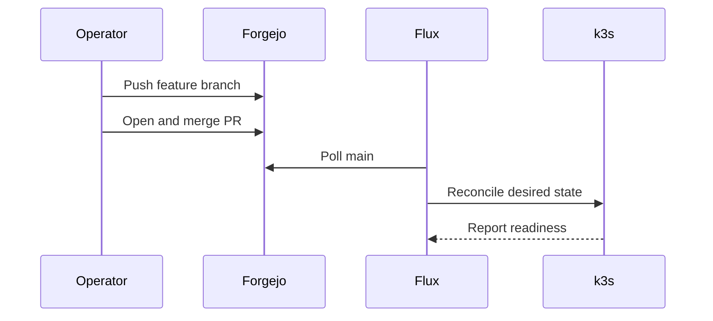

# GitOps Workflow

## Source of truth

Forgejo hosts the primary `NovaLabs/lovelace-cluster` repository. The `main` branch represents the desired cluster state. GitHub is a push mirror and is not used for deployment decisions.



## Branch and pull-request flow

Create one focused branch per change:

```bash
git switch main
git pull --ff-only
git switch -c <type>/<short-description>
```

Common branch prefixes include `feat/`, `fix/`, `docs/`, and `chore/`.

Before committing:

```bash
git diff --check
kubectl kustomize <changed-overlay> | kubectl apply --dry-run=client -f -
```

After review, merge the pull request in Forgejo. The branch may then be deleted. The GitHub mirror receives the updated branch state according to its configured mirror schedule.

## Flux entry points

The manifests under `clusters/staging` define the reconciliation boundaries:

- `apps.yaml`
- `infrastructure.yaml`
- `monitoring.yaml`
- `flux-system/`

Do not edit generated Flux bootstrap components casually. Application and platform changes normally belong under `apps`, `infrastructure`, or `monitoring`.

### Flux system upgrades

The Flux installation is managed as a coordinated release.

- `gotk-components.yaml` contains generated controller Deployments,
  CRDs, RBAC, and supporting resources.
- Renovate's Flux manager handles installation release updates.
- Renovate's Kubernetes manager must not independently update
  controller images in the generated manifest.
- Review release notes, API changes, and CRD compatibility before
  merging Flux upgrades.
- Preserve the existing bootstrap configuration and scheduling
  overlays when regenerating manifests.
- Validate controller readiness and reconciliation after upgrades.

Do not manually upgrade individual Flux controller image tags.

#### Review and validate a coordinated Flux upgrade

1. Confirm Renovate identifies `fluxcd/flux2` as a **Flux-manager** update,
   and review the full PR diff. Generated installation changes may include
   controller images, CRDs, RBAC, and supporting resources; matching image
   versions alone is not sufficient.
2. Read the release notes for Kubernetes minimum versions, API/storage
   migrations, authentication/RBAC changes, and removed fields. Inspect
   actual cluster resources for usage of affected features.
3. If the PR is behind `main`, request a rebase using Renovate's
   **rebase/retry** checkbox. The request is processed on a later Renovate
   CronJob run. Fetch and validate the new commit before approval.
4. Check that the proposed branch is based on current `main` and only changes
   intended installation resources:

   ```bash
   git fetch origin
   git log --oneline --left-right origin/main...origin/renovate/fluxcd-flux2-2.x
   git diff --stat origin/main...origin/renovate/fluxcd-flux2-2.x
   ```

5. Use a separate, detached Git worktree for validation; do not change the
   main working tree. Verify the Kubernetes context and render the
   **complete** Kustomization, including `scheduling.patch.yaml`:

   ```bash
   git worktree add --detach ../lovelace-flux-review origin/renovate/fluxcd-flux2-2.x
   kubectl kustomize ../lovelace-flux-review/clusters/staging/flux-system
   kubectl apply --dry-run=server -k ../lovelace-flux-review/clusters/staging/flux-system
   ```

   Confirm all four Deployments retain `novalabs.io/node-pool: core`.
   The server dry-run validates resources without applying them. Warnings
   about a missing `kubectl.kubernetes.io/last-applied-configuration`
   annotation may appear because Flux uses server-side apply; do not add
   the annotation merely to silence the dry-run warnings.

#### Recovery checkpoint and rollout

Before merging a Flux self-upgrade:

- Record the known-good `main` commit, `flux get kustomizations -A`,
  current controller images, and `flux check` results.
- Export the current Flux CRDs and custom resources for reference.
- Take a **consistent** backup of the k3s datastore and securely preserve
  the matching k3s server token. For SQLite/WAL, use SQLite's online backup
  API rather than copying only the live `state.db`. Verify backup integrity,
  restrict permissions, and keep credentials out of Git.
- Maintain an independent recovery path with `kubectl`. A Git revert does
  not necessarily reverse CRD storage migrations; a local datastore copy
  is not a substitute for an off-node, restore-tested disaster-recovery plan.

Observe the Deployments while merging the reviewed PR in Forgejo:

```bash
kubectl get deployments -n flux-system -w
```

After rollout, verify the intended controller image versions, all Pods
ready with no recurring restarts, all Flux Kustomizations `Ready=True`,
and the new applied Git revision:

```bash
kubectl get deployments -n flux-system -o wide
kubectl get pods -n flux-system -o wide
flux get kustomizations -A
flux check
```

The Flux CLI installed on the operator host is **separate** from the
in-cluster controller installation. If it is behind the cluster release,
upgrade it independently using the versioned official release and verified
checksum, preserving the previous binary for rollback. Do not apply the
Flux installation imperatively as part of the normal GitOps upgrade.

**Validated upgrade (2026-10-26):** PR #88 upgraded Flux v2.9.6 to
v2.10.0. All four controller versions matched the release, the custom
node-pool scheduling overlay rendered correctly, server dry-run passed,
five Kustomizations returned Ready, and `flux check` passed after updating
the standalone CLI to v2.10.0. Baseline `main`: `4b645be3`;
post-merge revision: `5df0ad5e`.

## Reconciliation behavior

The primary Flux Kustomizations reconcile every minute, retry every minute, and use a five-minute timeout. Pruning is enabled generally, with explicit protection on the Minecraft PV and PVC.

Inspect status:

```bash
flux get sources git -A
flux get kustomizations -A
flux get helmreleases -A
```

Request an immediate reconciliation:

```bash
flux reconcile source git flux-system -n flux-system
flux reconcile kustomization apps --with-source
```

Use the matching Kustomization name for infrastructure or monitoring changes.

## Drift

Flux continuously restores the declared state. Imperative edits made with `kubectl edit`, `kubectl patch`, or direct `kubectl apply` may be reverted at the next reconciliation.

Use imperative commands for inspection and carefully scoped diagnostics. Make durable changes in Git.

## GitHub mirror behavior

The mirror reflects Forgejo's Git references. A mirror is not bidirectional collaboration:

- Merge changes in Forgejo.
- Run Renovate against Forgejo.
- Do not rely on GitHub-only PRs or branches; mirror pruning can close or remove them.
- Use GitHub for visibility and an additional remote copy, not as a competing source of truth.